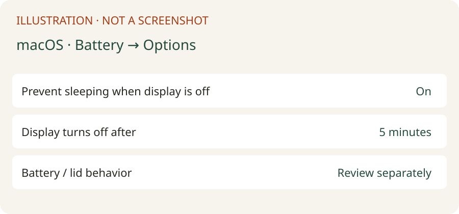
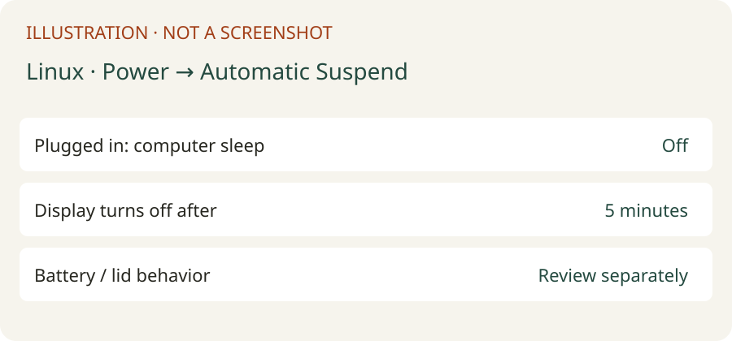
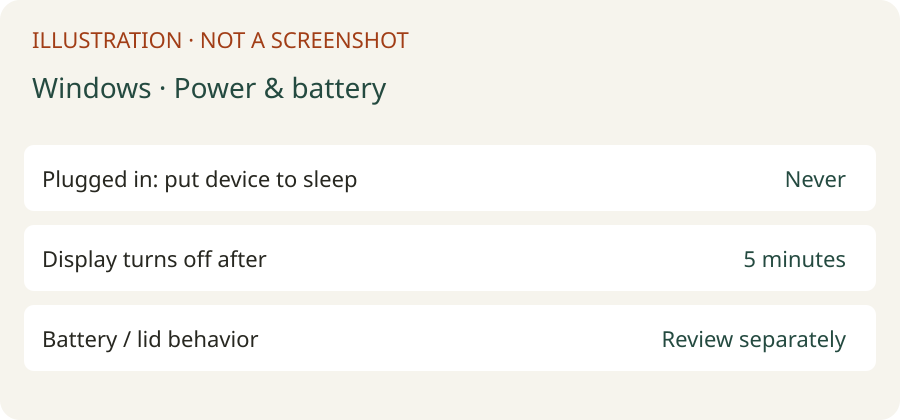

# Keep the Agent J host awake

Your phone needs the Agent J host to stay on and connected. **The screen can turn off while the Agent J host keeps working.** Keep it plugged in. Keeping a battery-powered laptop awake increases heat and drain; never put a running laptop in a bag. This does not prevent shutdown, battery exhaustion, firmware safety actions or network outages.

[AI tool setup](/docs/setup-agents/) · [Install Agent J](/docs/install/) · [On the Agent J host](/docs/computer/) · [Manual installation](/install/)

## The quick way: one question

Run this in a terminal on the Agent J host. Enter means yes:

```bash
agentj keep-awake setup
```

A yes does three things:

- **No sleep while plugged in.** The screen still turns off.
- **Closing the lid does not put it to sleep.** On Linux this comes with the yes (`--no-lid` keeps the usual lid sleep). On a Mac it asks a second time first, see below.
- **Linux: starts at boot.** Agent J runs after a restart, even before anyone logs in.

Each system change is a password card on your paired phone. Afterwards the command reads the settings back, prints ✓ or ✗ for each one, and tells you how to undo it.

You are asked this once, in one of these places:

- The one-command install asks it as its last step, once your phone is paired.
- Otherwise the main Agent asks on the phone once setup is done: a card whose first option is yes. You can also ask your Agent at any time; it runs `agentj keep-awake setup --phone`.
- You already said yes to your Agent in chat: it runs `agentj keep-awake setup --yes`.

If it was already asked, `agentj keep-awake setup --once` says so and asks nothing. To put your old sleep settings back:

```bash
agentj keep-awake off
```

On Linux, to stop Agent J from starting at boot:

```bash
loginctl disable-linger
```

### A Mac with the lid closed: shut it down yourself

> **Important:** once the lid setting is on, a closed Mac neither sleeps nor shuts down. Before a long flight, a long time away from the network, or whenever Agent J has nothing to do, **shut the Mac down yourself**. Closing the lid is not enough.

That is why a Mac asks about the lid a second time, with this reminder. The setting also holds on battery. While it is on, `agentj keep-awake status` and `agentj doctor` repeat the reminder every time. `agentj keep-awake off` puts the original value back. When your Agent asks in chat, `--yes` alone never changes a Mac's lid; it adds `--lid` only after you said yes to the lid as well.

## Give this to your Agent

Copy this request into your Agent conversation. With Agent J, the administrator password belongs on the paired phone card, never in chat. The button copies the same request and opens your Agent J phone page; select your paired computer and paste/send it yourself. The website does not send commands to a host.

```text
Configure the Agent J host to remain reachable for remote Agent work while allowing its display to turn off. Identify macOS, a native Linux systemd host, or Windows/WSL first. Read https://agentj.app/docs/keep-awake/en.md. Prefer the installed command agentj keep-awake setup --phone: it asks the owner on the paired phone (first option = yes), then keeps the host awake on power, keeps a closed lid awake and, on Linux, starts Agent J at boot; allow the shell call up to 10 minutes for the phone cards. If the owner already said yes in this chat, run agentj keep-awake setup --yes instead. macOS lid: before adding --lid, tell the owner that a closed Mac will then neither sleep nor shut down, so they must shut it down themselves before a long flight, a long time away from the network, or when Agent J has nothing to do; add --lid only after they say yes to that too. For finer control use status --json, on --dry-run --json, then on --json (add --lid for the lid). Do not change battery policy without explaining heat/drain and obtaining the owner's preference. Root operations must use Agent J's existing phone password card; never request a password in chat, ask the owner to type terminal commands, use osascript with administrator privileges, or open a local authorization dialog. If the command is unavailable, inspect supported OS-native commands and preserve original settings before applying equivalent changes through agentj sudo. WSL changes cannot keep Windows awake: report the host operations needed (sleep and the lid on AC), never claim success inside WSL. Do not edit PAM, disable Touch ID/Watch, or set disablesleep without the owner's second yes. If sudo reports local biometric authorization, explain that remote password submission alone cannot finish it and stop only that dependent operation. Relay the ✓/✗ lines the command prints; report AC/battery sleep policy, the lid, start at boot on Linux, whether verification passed, any restart or host-side step needed, and how to undo it with agentj keep-awake off. Never infer success from an exit code alone.
```

This command is available in the current release. If an older version reports an unknown command, update Agent J on your computer first; it does not mean your password is wrong.

## macOS

### Command line

Agent J's command uses `pmset`, defaults to **AC only**, leaves display and battery timers unchanged, saves the original sleep timers, and verifies the readback. Without `--lid` no `disablesleep` is set.

View the current settings (AC and Battery sections):

```bash
pmset -g custom
```

Preview without writes or phone cards:

```bash
agentj keep-awake on --dry-run --json
```

Apply using the phone password card:

```bash
agentj keep-awake on --json
```

Verify:

```bash
agentj keep-awake status --json
```

For deliberate battery use (more drain; not a lid workaround):

```bash
agentj keep-awake on --power battery --json
```

Keep a closed lid awake too, only after the owner's second yes (it sets `pmset -c disablesleep 1`, which also holds on battery):

```bash
agentj keep-awake on --lid --json
```

Restore the original timers and lid value saved by this command:

```bash
agentj keep-awake off --json
```

Without Agent J, for local manual installation only: record `pmset -g custom` first, then disable idle sleep on mains. An installed Agent should run the underlying command through `agentj sudo` instead of sending you to Terminal.

```bash
sudo pmset -c sleep 0
```

Read back `sleep 0` under AC. To restore, replace `20` below with the **original AC sleep minutes you recorded**, not an assumed default:

```bash
sudo pmset -c sleep 20
```

`-c` = charger, `-b` = battery, `-a` = both. `sleep 0` disables idle sleep; it does not keep a closed MacBook awake. `pmset disablesleep 1` does: a closed Mac then neither sleeps nor shuts down, on battery too, which adds heat and drain. Agent J sets it only after the owner's second yes, and the owner then shuts the Mac down before travel or long idle time. `caffeinate -i` is temporary and lasts only while its process runs.

### System Settings

1. Apple menu → System Settings → Battery → Options (laptops). Enable “Prevent automatic sleeping on power adapter when the display is off”. Desktop Macs: Energy → prevent automatic sleeping; wording varies by macOS/model.
2. Lock Screen → choose a display-off timer for the power adapter. This is separate from computer sleep; you may leave the display timer short.
3. Keep the laptop plugged in. Read `pmset -g custom` again and check the phone remains connected after the display turns off.
4. To undo, put the switch/timers back to the values you recorded. Factory defaults differ by hardware/macOS; `off` restores Agent J's own saved values only, not manual GUI changes.



Illustration, not a real screenshot. Mac window capture was unavailable in this environment. [Apple sleep settings](https://support.apple.com/guide/mac-help/set-sleep-and-wake-settings-mchle41a6ccd/mac)

### A second password or Touch ID dialog on the Agent J host

The phone may ask Face ID/passkey to approve its card, then the Agent J host login password. Those are separate expected checks **on the phone**. A further dialog **on the Mac** is different. `sudo -S -k` accepts a password on stdin, but a configured `pam_tid.so`/`pam_reattach.so`/Watch module may request local authorization before password authentication. Agent J detects known enabled modules, warns on the signed card and refuses the password sudo execution rather than hanging on a remote dialog. The preflight cannot prove arbitrary third-party PAM modules are safe.

Inspect without changing anything:

```bash
cat /etc/pam.d/sudo
```

```bash
cat /etc/pam.d/sudo_local
```

If active biometric lines are present, an owner **at the Agent J host** can review them with the commands below and comment only those biometric lines, preserving the password path. Back up the file first; do not replace the entire PAM file. This is a local recovery instruction, not an Agent's remote action.

```bash
sudoedit /etc/pam.d/sudo_local
```

Old configurations may put the lines directly in `/etc/pam.d/sudo`; review that file locally instead. Never remove password authentication. If no such lines exist, inspect which exact command caused the dialog: `osascript … with administrator privileges`, GUI System Settings, and some `security`/`softwareupdate` operations can use macOS Authorization Services independently of the phone password. Agent J must choose a supported direct CLI via its phone sudo card, or clearly report the local requirement. There is no verified universal bypass. [Apple pam_tid source](https://github.com/apple-oss-distributions/pam_modules/blob/main/modules/pam_tid/pam_tid.c)

## Linux

### Command line

For a **native systemd host**, Agent J persistently masks sleep, suspend, hibernate, hybrid-sleep and suspend-then-hibernate targets. It reads their status and logind lid/idle configuration, restores only masks it added, and does not restart logind (which could disconnect you). An already existing runtime mask remains runtime-only; reboot can remove it, so status reports that distinction. A container/WSL is not the host power manager.

View current settings:

```bash
agentj keep-awake status --json
```

Preview:

```bash
agentj keep-awake on --dry-run --json
```

Apply through the paired-phone password card:

```bash
agentj keep-awake on --json
```

Keep a closed lid awake on power too (`setup` does this with its yes):

```bash
agentj keep-awake on --lid --json
```

`--lid` writes Agent J's own logind file `/etc/systemd/logind.conf.d/90-agentj-keep-awake.conf` with `HandleLidSwitchExternalPower=ignore`. Your own logind.conf and other files stay untouched, and logind is not restarted (that could end your desktop session). The file counts from the next restart; until then the masked sleep targets already keep a closed lid awake. `agentj keep-awake off` removes only this file. A file of that name that Agent J did not create is left alone and the command stops.

Start at boot: `agentj keep-awake setup` also turns on linger (`loginctl enable-linger`), so Agent J runs after a restart before anyone logs in. It tries without a password first, then with a phone password card. To undo: `loginctl disable-linger`.

Verify targets:

```bash
systemctl is-enabled sleep.target suspend.target hibernate.target hybrid-sleep.target suspend-then-hibernate.target
```

Read logind configuration:

```bash
systemd-analyze cat-config systemd/logind.conf
```

Restore only this command's changes:

```bash
agentj keep-awake off --json
```

For manual installation without Agent J: record existing masks first, then:

```bash
sudo systemctl mask sleep.target suspend.target hibernate.target hybrid-sleep.target suspend-then-hibernate.target
```

To undo a manual mask, unmask **only the targets you added**. Example if sleep.target was originally unmasked:

```bash
sudo systemctl unmask sleep.target
```

logind's `HandleLidSwitch`, `HandleLidSwitchExternalPower`, `HandleLidSwitchDocked` and `IdleAction` determine default lid/idle actions. A desktop power manager can take over these events. Masking targets blocks normal systemd sleep requests, including many lid requests; it cannot promise every firmware or desktop behavior. Leave screen blanking enabled and test your actual machine. No logind restart or broad config replacement is automated. [systemd logind reference](https://www.freedesktop.org/software/systemd/man/latest/logind.conf.html)

### Graphical settings

1. GNOME: Settings → Power → Automatic Suspend → turn off “Plugged In”. KDE Plasma: System Settings → Power Management → On AC Power → disable Suspend Session. Names vary by version/distribution.
2. Leave screen blanking/display power saving enabled. Set battery suspend separately only when needed; set lid behavior in your desktop's power settings if exposed.
3. Wait past the old suspend timeout and confirm your paired phone still reaches the host; read the command status as well.
4. Restore the switches/timers you recorded. There is no one Linux-wide factory default. If your desktop has no graphical power panel, use the command route; do not install a desktop panel just for this page.



Illustration, not a real screenshot. This Linux machine has no GNOME/KDE power settings panel.

## Windows

### Command line (Windows host, including WSL users)

Run these in **Windows PowerShell on the host**. WSL's `agentj keep-awake` (and `agentj keep-awake setup`) prints these steps and does not execute Windows power changes or open a local UAC prompt. If elevated rights are required by your policy, perform that host-side step while at the Agent J host; Agent J's Unix phone sudo card cannot approve Windows UAC.

Record the active plan and its sleep/hibernate/lid values:

```powershell
powercfg /getactivescheme
```

```powershell
powercfg /query SCHEME_CURRENT SUB_SLEEP
```

```powershell
powercfg /query SCHEME_CURRENT SUB_BUTTONS
```

Disable idle sleep on AC:

```powershell
powercfg /change standby-timeout-ac 0
```

Disable AC idle hibernation:

```powershell
powercfg /change hibernate-timeout-ac 0
```

Verify the two AC values in the same plan (`0` means no timer):

```powershell
powercfg /query SCHEME_CURRENT SUB_SLEEP
```

Lid closed on AC: do nothing (`0`). Note the original lid value from the `SUB_BUTTONS` query first:

```powershell
powercfg /setacvalueindex SCHEME_CURRENT SUB_BUTTONS LIDACTION 0
```

Make the change effective:

```powershell
powercfg /setactive SCHEME_CURRENT
```

Restore original sleep minutes, for example **20 only if that was your recorded value**:

```powershell
powercfg /change standby-timeout-ac 20
```

Restore original hibernate minutes, for example **60 only if recorded**:

```powershell
powercfg /change hibernate-timeout-ac 60
```

`/query` displays setting indexes in hexadecimal **seconds**; `/change` takes **minutes**. Convert seconds to minutes accurately, or use `/setacvalueindex` for an exact original seconds value. Use `-dc` variants only deliberately for battery mode; AC settings do not change battery policy. Avoid `powercfg /restoredefaultschemes`: it deletes custom power plans. Standby timers do not change lid actions (`LIDACTION` does) or override managed device policies/Modern Standby. To undo the lid, run the same `/setacvalueindex` line with the value you noted, then `/setactive` again. Let the display turn off and keep a laptop plugged in and ventilated. [Microsoft powercfg reference](https://learn.microsoft.com/en-us/windows-hardware/design/device-experiences/powercfg-command-line-options)

### Settings and Control Panel

1. Windows 11: Settings → System → Power & battery → Screen, sleep & hibernate timeouts (older builds: Screen and sleep). Set “When plugged in, put my device to sleep after” to Never. Keep the screen-off timer as desired. Windows 10: Settings → System → Power & sleep.
2. Control Panel → Hardware and Sound → Power Options → Choose what closing the lid does. On AC, choose “Do nothing” only if the laptop stays ventilated; leave battery behavior unchanged unless you intend otherwise.
3. Read the host powercfg settings again; leave WSL running and confirm the phone remains connected after the display turns off.
4. Restore your recorded plan values/switches. WSL shutdown or computer restart stops the host even when sleep is disabled.



Illustration, not a real screenshot. A physical Windows screenshot is still needed.

## After the Agent J host restarts

Agent J brings back what it needs by itself, so you can keep working from the phone without touching the computer:

1. **Your shared Claude session.** If you pinned a shared Claude Code session and it is gone after the restart, Agent J resumes it in the background (`claude --resume`). A session you closed yourself since the restart stays closed.
2. **Your own OpenCode server.** If Settings point Agent J at your own OpenCode on a port and it is not running, the phone asks what to do. Choose the recommended first option and Agent J starts it on that port and reconnects; the other option leaves it to you at the computer. If it had a password and Agent J does not have that password, Agent J never starts it without one: the card asks you to start it on the computer yourself, or to give Agent J the password with the secret card.
3. **Scheduled tasks.** Runs missed while the computer was off or asleep are not run in a row. You get one notice saying how many were missed, and a card where you tick the tasks to run once now.
4. **Folder trust.** Before Agent J starts Claude Code itself, it makes sure the work folder is trusted, so the start never waits on a trust question.
5. **Agent J's own browser.** If it was closed, it opens again the next time it is needed. If Agent J uses your own Chrome, it does not open it for you; it tells you instead.

Agent J itself: on Linux with start at boot on (see above), it runs without anyone logging in. A Mac with FileVault needs one login after a restart; then Agent J starts by itself. To power a Mac on again after a power cut, you can run `sudo pmset autorestart 1` yourself; Agent J only mentions it and never sets it.

Keeping the Agent J host awake is one item of the [first-run checklist](/docs/first-run/); your Agent checks there that it actually took effect.
