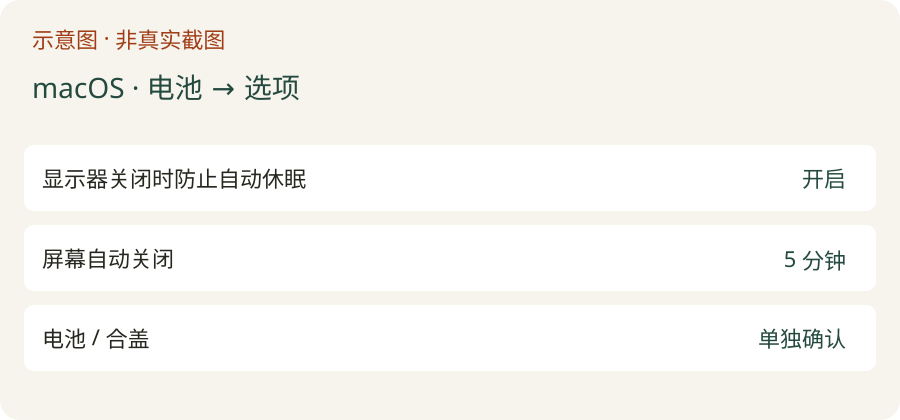
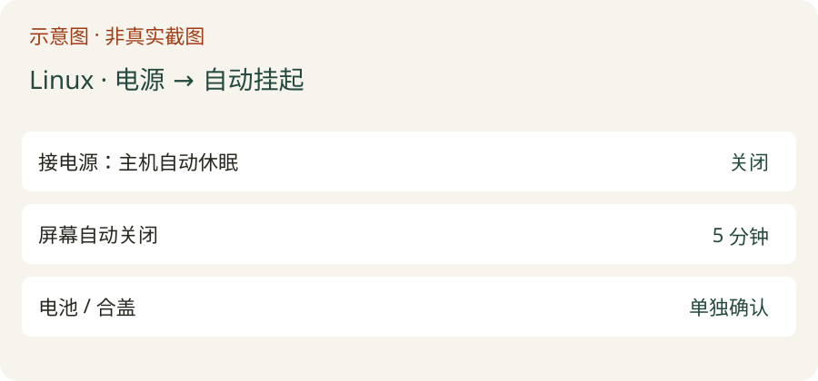
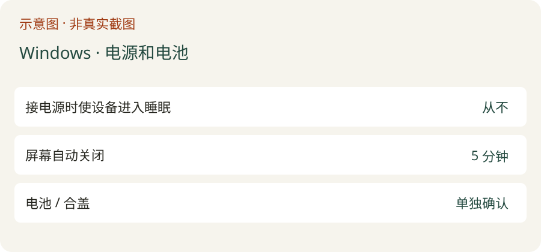

# 让Agent J 主机保持唤醒

手机遥控需要Agent J 主机持续开机、联网。**屏幕关闭，不等于Agent J 主机休眠。** 请一直接着电源。电池供电时持续唤醒会增加耗电和发热，运行中的笔记本不要放进包里。这些设置不能防止关机、电池耗尽、固件保护或断网。

[AI 工具手动安装](/docs/setup-agents/) · [安装 Agent J](/docs/install/) · [Agent J 主机端说明](/docs/computer/) · [手动安装](/install/)

## 最快的办法：回答一个问题

在Agent J 主机的终端里运行下面这条命令，直接回车就是同意：

```bash
agentj keep-awake setup
```

同意后会做三件事：

- **插着电不自动睡眠。** 屏幕照样会关。
- **合上盖子也不睡。** Linux 上随这次同意一起设好（加 `--no-lid` 就让合盖照常睡）；Mac 会再问你一次，见下文。
- **Linux：开机自动运行。** 电脑重启后，没人登录 Agent J 也会运行。

每一项系统改动都会在已配对的手机上弹一张密码卡。做完后命令会读回设置，每项打印 ✓ 或 ✗，并告诉你怎么撤销。

这个问题只问一次，会出现在下面某个地方：

- 一键安装的最后一步：手机配对好以后会问。
- 没在终端问过的话，新手引导结束后主 Agent 会在手机上问一次：弹一张卡片，第一项就是同意。你也可以随时跟 Agent 说，它会运行 `agentj keep-awake setup --phone`。
- 你已经在聊天里答应了 Agent：它会运行 `agentj keep-awake setup --yes`。

已经问过的话，`agentj keep-awake setup --once` 会说明已问过，不再提问。想恢复原来的休眠设置：

```bash
agentj keep-awake off
```

Linux 上不想开机自动运行：

```bash
loginctl disable-linger
```

### Mac 合盖不睡：记得主动关机

> **重要：** 合盖设置打开后，合上盖子的 Mac 既不睡也不关机。长时间坐飞机、长时间离开网络，或者不需要 Agent J 干活时，**一定要主动关机**。光合上盖子不够。

所以 Mac 会带着这条提醒，就合盖再问你一次。这项设置用电池时也生效。打开期间，`agentj keep-awake status` 和 `agentj doctor` 每次都会重复这条提醒。`agentj keep-awake off` 会恢复原来的值。Agent 在聊天里问你时，单用 `--yes` 不会改 Mac 的合盖设置；你对合盖也同意了，它才会加 `--lid`。

## 交给你的 Agent

复制下面的请求，发到你的 Agent 对话里。使用 Agent J 时，管理员密码只填在已配对手机的密码卡里，不能发在聊天里。按钮会复制同一段请求并打开 Agent J 手机页面；选择已配对Agent J 主机后，由你粘贴并发送。官网不会直接向Agent J 主机发送命令。

```text
请把这台Agent J 主机设置为适合远程 Agent 工作的持续在线状态，同时允许屏幕关闭。先判别 macOS、原生 Linux systemd 主机或 Windows/WSL，阅读 https://agentj.app/docs/keep-awake/zh.md。优先使用已安装的命令 agentj keep-awake setup --phone：它会在主人已配对的手机上提问（第一项 = 是），然后让主机插电不休眠、合盖也不睡，Linux 上还会让 Agent J 开机自动运行；shell 超时设为 10 分钟，给手机密码卡留足时间。主人已经在本次对话里同意，就改为运行 agentj keep-awake setup --yes。macOS 合盖：加 --lid 之前，先告诉主人合盖后 Mac 既不睡也不关机，长时间坐飞机、长时间离开网络或不需要 Agent J 干活时必须自己主动关机；主人对这一条也同意后才加 --lid。需要细调时用 status --json，再 on --dry-run --json，确认后执行 on --json（合盖加 --lid）。调整电池策略前说明耗电和发热，并确认主人的偏好。所有 root 操作必须走 Agent J 已有的手机密码卡，不在对话里索要密码，不让主人开终端敲命令，不使用 osascript with administrator privileges，也不触发Agent J 主机本机授权窗口。若命令尚未提供，先检查系统支持的原生命令并保存原设置，再通过 agentj sudo 做等价调整。WSL 内的修改不能阻止 Windows 宿主休眠，必须明确报告宿主侧需要的操作（休眠和插电合盖），不冒充已成功。不要修改 PAM、关闭 Touch ID/Apple Watch；没有主人的第二次同意，不要设置 disablesleep。若 sudo 报告本机生物验证风险，说明手机提交密码不能独立完成，只暂停依赖这项提权的操作。把命令打印的 ✓/✗ 结果告诉主人；报告接电源/电池休眠策略、合盖、Linux 开机自动运行、验证是否通过、是否需要重启或宿主侧操作，以及用 agentj keep-awake off 恢复的方法。不能只凭退出码宣称成功。
```

当前版本已支持此命令。旧版本提示未知命令时，先升级主机程序，不能据此判断密码错误。

## macOS

### 命令行做法

内置命令使用 `pmset`，默认**只改接电源时的主机休眠时间**，保留屏幕和电池策略；先保存原值，完成后读回验证。不加 `--lid` 时不设置 `disablesleep`。

查看当前设置，分别看 AC Power 和 Battery Power：

```bash
pmset -g custom
```

只预览，不写文件、不发密码卡：

```bash
agentj keep-awake on --dry-run --json
```

执行，管理员密码填手机卡片：

```bash
agentj keep-awake on --json
```

验证：

```bash
agentj keep-awake status --json
```

明确需要电池供电时也不自动休眠，才使用这一项；它增加耗电，不能解决合盖问题：

```bash
agentj keep-awake on --power battery --json
```

合盖也不睡，只在主人第二次同意之后才用（它会设置 `pmset -c disablesleep 1`，用电池时也生效）：

```bash
agentj keep-awake on --lid --json
```

恢复本命令保存的原休眠时间和合盖设置：

```bash
agentj keep-awake off --json
```

还没安装 Agent J、在Agent J 主机前手动安装时：先记录 `pmset -g custom` 的原值，再关闭接电源时的自动休眠。已安装的 Agent 应通过 `agentj sudo` 执行底层命令，不把你赶回终端。

```bash
sudo pmset -c sleep 0
```

读回 AC Power 下的 `sleep 0`。恢复时把下面的 `20` 换成**之前记录的接电源休眠分钟数**，不是固定默认值：

```bash
sudo pmset -c sleep 20
```

`-c` 表示接电源，`-b` 表示电池，`-a` 表示两种供电。`sleep 0` 关闭闲置自动休眠，但合上盖子的 MacBook 仍会睡。`pmset disablesleep 1` 能让它不睡：合盖后 Mac 既不睡也不关机，用电池时也一样，会增加发热和耗电。Agent J 只在主人第二次同意之后才设置它；之后出门或长时间不用时，由主人主动关机。`caffeinate -i` 只在该进程运行期间临时有效。

### 图形界面做法

1. 笔记本：苹果菜单 → 系统设置 → 电池 → 选项，开启接电源且显示器关闭时防止自动休眠的选项。台式 Mac：能源 → 防止自动休眠。名称随 macOS 和机型变化。
2. 锁定屏幕 → 设置接电源时关闭显示器的时间。这是屏幕计时，与主机休眠不同，可以保持较短时间。
3. 笔记本接着电源，重新查看 `pmset -g custom`；屏幕关闭后确认手机仍能连接。
4. 撤销时恢复之前记录的开关和时间。出厂默认值因机型和系统而异；`off` 只恢复 Agent J 自己保存的原值，不恢复手动改动的所有设置。



这是示意图，不是真实截图。本次环境无法截取 Mac 系统设置窗口。[Apple 休眠设置说明](https://support.apple.com/guide/mac-help/set-sleep-and-wake-settings-mchle41a6ccd/mac)

### 手机输密码后，Agent J 主机又弹验证

手机可能先用 Face ID/通行密钥批准卡片，再输入Agent J 主机登录密码；这是**手机上的两项正常检查**。如果之后**Mac 本机**又弹验证，则是另一条授权路径。`sudo -S -k` 从标准输入接收密码，但启用的 `pam_tid.so`、`pam_reattach.so` 或 Watch 模块可能先调用本机授权。Agent J 检测已知启用项，在签名卡片里提示风险，并拒绝密码 sudo 执行，避免远程卡在本机弹窗。此检查不能保证所有第三方 PAM 模块都安全。

只读检查，不改配置：

```bash
cat /etc/pam.d/sudo
```

```bash
cat /etc/pam.d/sudo_local
```

若有未被注释的生物验证行，主人**在Agent J 主机前**可用下面的命令检查，先备份原文件，只注释相关生物验证行，保留密码认证。不要替换整个 PAM 文件。这是本机恢复指引，不是让 Agent 远程自动修改。

```bash
sudoedit /etc/pam.d/sudo_local
```

旧配置可能写在 `/etc/pam.d/sudo`，则在Agent J 主机前检查该文件。不要删除密码认证。如果没有相关行，应查清究竟哪条命令引发弹窗：`osascript … with administrator privileges`、系统设置 GUI，以及部分 `security`、`softwareupdate` 操作可能独立调用 macOS 授权服务，手机密码不能替代。Agent J 应改用支持的直接命令，通过手机 sudo 卡执行；确需本机操作则如实报告。没有已验证的通用旁路。[Apple pam_tid 源码](https://github.com/apple-oss-distributions/pam_modules/blob/main/modules/pam_tid/pam_tid.c)

## Linux

### 命令行做法

适用于**原生 systemd 主机**。内置命令持久屏蔽休眠、挂起、冬眠、混合休眠与先挂起后冬眠的 targets，读回状态及 logind 合盖/闲置配置；只撤销自己加的屏蔽，不重启 logind，避免断开桌面。如果原本已有临时屏蔽，会保留它，重启可能使它失效，状态会区分临时与持久屏蔽。容器和 WSL 都不是宿主电源管理器。

查看：

```bash
agentj keep-awake status --json
```

预览：

```bash
agentj keep-awake on --dry-run --json
```

执行，通过已配对手机密码卡审批：

```bash
agentj keep-awake on --json
```

合盖也不睡（`setup` 得到同意时会一起做）：

```bash
agentj keep-awake on --lid --json
```

`--lid` 会写入 Agent J 自己的 logind 配置文件 `/etc/systemd/logind.conf.d/90-agentj-keep-awake.conf`，内容是 `HandleLidSwitchExternalPower=ignore`（插电合盖时不做任何事）。你自己的 logind.conf 和其他文件都不动，也不重启 logind（重启可能让桌面会话退出）。这个文件在下次重启后正式生效；在那之前，已屏蔽的睡眠 target 同样让合盖不睡。`agentj keep-awake off` 只删除这一个文件。同名文件如果不是 Agent J 建的，命令会停下，不去动它。

开机自动运行：`agentj keep-awake setup` 还会打开 linger（`loginctl enable-linger`），电脑重启后没人登录 Agent J 也会运行。它先试不用密码，不行再弹手机密码卡。撤销：`loginctl disable-linger`。

验证各 target：

```bash
systemctl is-enabled sleep.target suspend.target hibernate.target hybrid-sleep.target suspend-then-hibernate.target
```

查看 logind 配置：

```bash
systemd-analyze cat-config systemd/logind.conf
```

恢复本命令的修改：

```bash
agentj keep-awake off --json
```

未安装 Agent J、在Agent J 主机前手动设置时，先记录已有屏蔽，再执行：

```bash
sudo systemctl mask sleep.target suspend.target hibernate.target hybrid-sleep.target suspend-then-hibernate.target
```

手动撤销时，只解除**这次新加的屏蔽**。例如 sleep.target 原来未被屏蔽：

```bash
sudo systemctl unmask sleep.target
```

logind 的 `HandleLidSwitch`、`HandleLidSwitchExternalPower`、`HandleLidSwitchDocked`、`IdleAction` 控制默认合盖和闲置行为，桌面电源管理器也可能接管这些事件。屏蔽 target 能阻止正常 systemd 休眠请求，包括许多合盖请求，但不能承诺覆盖所有固件和桌面行为。保留屏幕自动关闭，实测自己的Agent J 主机。本命令不自动重启 logind，不整体替换配置。[systemd logind 文档](https://www.freedesktop.org/software/systemd/man/latest/logind.conf.html)

### 图形界面做法

1. GNOME：设置 → 电源 → 自动挂起，关闭接电源时自动挂起。KDE Plasma：系统设置 → 电源管理 → 接电源，关闭挂起会话。名称随发行版和版本变化。
2. 保留屏幕空白/显示器节能；电池休眠策略按需要单独设置。若桌面提供合盖选项，在电源设置里调整。
3. 等待超过原挂起时间，确认手机仍能连接，再读回命令状态。
4. 恢复之前记录的开关和时间。Linux 没有统一出厂默认值。若桌面没有图形电源面板，使用命令行方式，不为本页额外安装桌面组件。



这是示意图，不是真实截图。本机 Linux 没有 GNOME/KDE 电源设置面板。

## Windows

### 命令行做法（含 WSL 宿主）

下面的命令必须在 **Windows 宿主的 PowerShell** 执行。WSL 中的 `agentj keep-awake`（以及 `agentj keep-awake setup`）只输出这些步骤，不修改 Windows，也不弹本机 UAC 窗口。若设备策略要求管理员权限，请在Agent J 主机前完成宿主侧操作；Agent J 的 Unix 手机 sudo 卡不能批准 Windows UAC。

记录当前电源计划、休眠/冬眠和合盖设置：

```powershell
powercfg /getactivescheme
```

```powershell
powercfg /query SCHEME_CURRENT SUB_SLEEP
```

```powershell
powercfg /query SCHEME_CURRENT SUB_BUTTONS
```

接电源时不自动睡眠：

```powershell
powercfg /change standby-timeout-ac 0
```

接电源时不自动冬眠：

```powershell
powercfg /change hibernate-timeout-ac 0
```

读回同一电源计划的 AC 值，`0` 表示没有计时：

```powershell
powercfg /query SCHEME_CURRENT SUB_SLEEP
```

插电合盖时不做任何事（`0`）。先从 `SUB_BUTTONS` 的查询结果里记下合盖的原值：

```powershell
powercfg /setacvalueindex SCHEME_CURRENT SUB_BUTTONS LIDACTION 0
```

让改动生效：

```powershell
powercfg /setactive SCHEME_CURRENT
```

恢复原睡眠分钟数，下面的 **20 只是已记录原值的示例**：

```powershell
powercfg /change standby-timeout-ac 20
```

恢复原冬眠分钟数，下面的 **60 也只是示例**：

```powershell
powercfg /change hibernate-timeout-ac 60
```

`/query` 的索引以十六进制**秒数**显示，`/change` 接收**分钟**；准确换算，或用 `/setacvalueindex` 恢复精确原秒数。电池模式用 `-dc`，仅在明确需要时设置；AC 设置不改变电池策略。避免 `powercfg /restoredefaultschemes`，它会删除自定义电源计划。睡眠计时不改变合盖行为（合盖由 `LIDACTION` 决定），也不能覆盖受管理设备策略和 Modern Standby。撤销合盖设置：用记下的原值再运行一次同样的 `/setacvalueindex`，再运行 `/setactive`。屏幕可以关闭，笔记本保持接电源、通风。[Microsoft powercfg 文档](https://learn.microsoft.com/en-us/windows-hardware/design/device-experiences/powercfg-command-line-options)

### 设置与控制面板

1. Windows 11：设置 → 系统 → 电源和电池 → 屏幕、睡眠和休眠超时（旧版本叫屏幕和睡眠），把接电源时设备睡眠设为从不；屏幕关闭时间按需保留。Windows 10：设置 → 系统 → 电源和睡眠。
2. 控制面板 → 硬件和声音 → 电源选项 → 选择关闭盖子的功能；只有在笔记本通风良好时，才把接电源的合盖行为改为不采取任何操作。电池策略默认保留。
3. 再读回宿主 powercfg 设置，保持 WSL 运行，屏幕关闭后确认手机仍能连接。
4. 恢复之前记录的电源计划原值和开关。即使禁用了休眠，关闭 WSL 或重启Agent J 主机也会停止主机。



这是示意图，不是真实截图，仍需补一台 Windows 真机截图。

## Agent J 主机重启以后

Agent J 会自己把需要的东西带起来，你不用碰电脑，直接在手机上接着干活：

1. **共享的 Claude 会话。** 你钉了一个共享的 Claude Code 会话，重启后它不在了，Agent J 会在后台把它接回来（`claude --resume`）。重启后你自己关掉的会话，不会再自动打开。
2. **你自己开的 OpenCode。** 设置里让 Agent J 连你自己在某个端口开的 OpenCode，而它没在运行，手机上会弹卡片问你。选推荐的第一项，Agent J 就在那个端口把它启动并接回；选另一项就由你在电脑上处理。如果它原来设过密码，而 Agent J 手里没有这把密码，它不会不设密码就替你启动，卡片会改为请你在电脑上自己启动，或用密钥卡把密码交给 Agent J。
3. **定时任务。** 关机或休眠期间错过的任务不会一口气补跑。你会收到一条通知，说错过了几次，再加一张卡片，勾选的任务各补跑一次。
4. **工作目录信任。** Agent J 自己启动 Claude Code 之前，会先确认工作目录已信任，启动不会卡在信任提示上。
5. **Agent J 专用浏览器。** 被关掉了，下次要用时会自动重新打开。如果 Agent J 用的是你自己的 Chrome，它不会擅自打开，会提示你。

Agent J 自己：Linux 上开了开机自动运行（见上文），重启后没人登录也会运行。开了 FileVault 的 Mac 重启后要登录一次，之后 Agent J 自动起来。想让 Mac 停电恢复后自动开机，可以自己运行 `sudo pmset autorestart 1`；Agent J 只提这一句，不会替你设置。

防休眠是[离开Agent J 主机前清单](/docs/first-run/)里的一项；Agent 会在清单里检查它是否真的生效。
