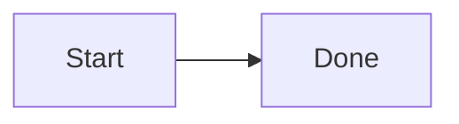

# Reply components / 回复内嵌组件

Generated from web/reply-components.json. Use ordinary Markdown first. Do not use HTML, JavaScript, external scripts or tool callbacks. A malformed or incomplete component stays source text; never rely on it for approvals.

优先用普通 Markdown。不要输出 HTML、JS、外部脚本或工具回调。组件写错或未写完只显示原文，不能拿它代替权限审批。

For structured components use one complete JSON object per fenced `agentj` block. No secrets in forms. Form and confirmation buttons ONLY append a draft; the owner reviews and presses Send. Existing reply: links retain their explicitly requested one-tap-send behavior. Persistent to-dos remain the owner's official card, not a form.

结构化组件每个 `agentj` 围栏只放一个完整 JSON 对象。表单不收密码、密钥或其他秘密。表单、确认卡按钮只填入草稿，主人检查后按发送；已有 reply: 选项保持单击发送。持久待办继续用官方待办卡。

Limits: 16000 characters per block, 20 components per reply. Unknown properties/types, oversized data, dangling flowchart edges and duplicate IDs fall back to text. Numbers must be finite. Links keep the existing URL filter and host-authorized local media path.

## link

External URL / 外部网址

Renderer: safeHref / shownTarget.

Parameters / 参数： {"label":"Visible text","href":"http:, https:, mailto: only; shows real host"}

Example / 示例：

```text
[label](https://example.com)
```

## internal-link

Internal navigation / 内部导航

Renderer: five-pages.linkify.

Parameters / 参数： {"address":"Known card/<id>[#anchor], /installed-skill, workflow mentions; no invented URL scheme"}

Example / 示例：

```text
card/cards
```

## quote

Quotation / 引用

Renderer: md blockquote.

Parameters / 参数： {"text":"Markdown > block; actions stay inert"}

Example / 示例：

```text
> quoted words
```

## file

Host-authorized Markdown, PDF, audio, video / 主机授权文件

Renderer: media / localRef.

Parameters / 参数： {"ref":"Host-authorized local path","mid":"Host media id","mime":"Markdown / PDF / audio / video; metadata comes from host"}

Example / 示例：

```text
[report.pdf](out/report.pdf)
```

## table

Markdown table / 表格

Renderer: md table.

Parameters / 参数： {"columns":"≤32","rows":"≤300","cells":"≤4000"}

Example / 示例：

```text
| Item | Count |
|---|---|
| Mug | 60 |
```

## reply

Existing one-tap reply / 原有单击发送选项

Renderer: replybtn / replyRef.

Parameters / 参数： {"label":"Visible choice","say":"One-line bounded reply: text; existing one-tap send"}

Example / 示例：

```text
[A](reply:A)
```

## todo

Owner-managed persistent checklist / 持久待办卡

Renderer: jcards.

Parameters / 参数： {"card":"Owner official To-do card; not an inline permission card"}

Example / 示例：

```text
Ask Agent J to update the To-do card / 请 Agent J 更新待办卡
```

## mermaid

Local strict Mermaid / 本地严格流程图

Renderer: render.diagram.

Parameters / 参数： {"source":"≤10000 chars; local strict rendering; text fallback"}

Example / 示例：

```text

```

## flowchart

Named nodes and directed edges / 节点与有向连线

Renderer: flowchart.

Parameters / 参数：

{"type":"object","properties":{"component":{"enum":["flowchart"]},"title":{"type":"string","maxLength":200},"nodes":{"type":"array","items":{"type":"object","properties":{"id":{"type":"string","maxLength":24},"label":{"type":"string","maxLength":120}},"required":["id","label"],"additionalProperties":false},"maxItems":24,"minItems":1},"edges":{"type":"array","items":{"type":"object","properties":{"from":{"type":"string","maxLength":24},"to":{"type":"string","maxLength":24}},"required":["from","to"],"additionalProperties":false},"maxItems":40,"minItems":1}},"required":["component","title","nodes","edges"],"additionalProperties":false}

Example / 示例：

```agentj
{"component":"flowchart","title":"Flowchart","nodes":[{"id":"a","label":"Review"},{"id":"b","label":"Done"}],"edges":[{"from":"a","to":"b"}]}
```

## chart

Finite numeric bar or line chart / 有限数值柱图或折线图

Renderer: chart.

Parameters / 参数：

{"type":"object","properties":{"component":{"enum":["chart"]},"title":{"type":"string","maxLength":200},"kind":{"enum":["bar","line"]},"items":{"type":"array","items":{"type":"object","properties":{"label":{"type":"string","maxLength":60},"value":{"type":"number","minimum":-1000000000,"maximum":1000000000}},"required":["label","value"],"additionalProperties":false},"maxItems":30,"minItems":1}},"required":["component","title","kind","items"],"additionalProperties":false}

Example / 示例：

```agentj
{"component":"chart","title":"Chart","kind":"bar","items":[{"label":"Mug","value":60},{"label":"Cap","value":40}]}
```

## steps

Read-only progress / 只读步骤条

Renderer: steps.

Parameters / 参数：

{"type":"object","properties":{"component":{"enum":["steps"]},"title":{"type":"string","maxLength":200},"items":{"type":"array","items":{"type":"object","properties":{"label":{"type":"string","maxLength":120},"status":{"enum":["pending","active","done"]}},"required":["label","status"],"additionalProperties":false},"maxItems":12,"minItems":1}},"required":["component","title","items"],"additionalProperties":false}

Example / 示例：

```agentj
{"component":"steps","title":"Steps","items":[{"label":"Review","status":"active"},{"label":"Deliver","status":"pending"}]}
```

## confirm

Draft only, never a permission approval / 只填草稿，不是权限批准

Renderer: confirm.

Parameters / 参数：

{"type":"object","properties":{"component":{"enum":["confirm"]},"title":{"type":"string","maxLength":200},"message":{"type":"string","maxLength":1000},"choices":{"type":"array","items":{"type":"string","maxLength":100},"maxItems":4,"minItems":1}},"required":["component","title","message","choices"],"additionalProperties":false}

Example / 示例：

```agentj
{"component":"confirm","title":"Confirm","message":"Review the proposed restock order.","choices":["Prepare order","Keep draft"]}
```

## form

Non-secret inputs → draft / 非秘密表单只生成草稿

Renderer: form.

Parameters / 参数：

{"type":"object","properties":{"component":{"enum":["form"]},"title":{"type":"string","maxLength":200},"fields":{"type":"array","items":{"type":"object","properties":{"id":{"type":"string","maxLength":24},"label":{"type":"string","maxLength":100},"type":{"enum":["text","select","checkbox","date"]},"options":{"type":"array","items":{"type":"string","maxLength":100},"maxItems":12,"minItems":1}},"required":["id","label","type"],"additionalProperties":false},"maxItems":8,"minItems":1}},"required":["component","title","fields"],"additionalProperties":false}

Example / 示例：

```agentj
{"component":"form","title":"Form","fields":[{"id":"note","label":"Notes","type":"text"}]}
```
